# ENH-011 — Scan-to-pay QR and an Arabic / English checkout

| | |
|---|---|
| **Type** | Enhancement (new merchant and customer feature; nothing was broken) |
| **Area** | UX · Local market fit |
| **Approved by** | Ebrahim, 2026-10-30 |
| **Status** | ✅ done |

## Summary

- **What it adds:** every live payment link gets a **scan-to-pay card**: a large QR code made in the browser, with copy, WhatsApp share, a printable PNG and a full-screen **counter display** that turns into "Paid — thank you!" when the customer pays. The public checkout gets an **English | عربي** switch with a real right-to-left layout.
- **Why it's worth it:** in Bahrain, people pay in shops by scanning a QR, and many customers would rather read Arabic. Today a merchant can only copy a long URL, and the checkout is English only. With this, a shop can put the link on a tablet at the till and an Arabic-speaking customer can pay in Arabic.
- **Cost / risk:** one small library (`qrcode@1.5.4`, MIT, about 25 KB, no network calls). Frontend only: no API, database or money logic changed. The QR contains only the link's existing public URL.

## 1. Today

- The payment-link page shows the checkout URL in a text box with Copy and Open buttons. To use it at a counter, the merchant has to type or send that URL themselves. There is no QR.
- Every checkout text is hard-coded English (`CheckoutPage.tsx`), and the page is always left-to-right.

This is not a bug: the spec only asks for a payment link. It is a gap for a Bahraini product, where QR payments and Arabic are normal.

## 2. Goal

| Who | What they notice |
|---|---|
| Merchant | The **Scan to pay** card on a live link: merchant name, `BD 12.500`, the QR, "Scan with your phone camera to pay" in English and Arabic, the expiry, and four actions. Paid, expired, canceled and in-progress links show a stamp instead of a QR. |
| Shop counter | **Counter display**: full screen, QR as big as the screen allows, the amount and both captions. Esc closes it. It checks the link every 4 s and shows **"Paid — thank you!" / "تم الدفع، شكراً لك!"** as soon as the payment lands. |
| Customer | **English \| عربي** switch on `/pay/:token`. In Arabic, the whole page is right-to-left with Arabic type. Card number, expiry and CVV stay left-to-right. The choice is remembered, and the first visit follows the phone's language. |
| Judge | The screenshots below. All four QR images decode to the exact checkout URL. |

## 3. Design options (ranked)

### QR code

| Rank | Option | Pros | Cons | Chosen? |
|---|---|---|---|---|
| 1 | **Make the QR in the browser** (`qrcode` library), drawn as our own inline SVG | No outside service sees the URL. Works offline. Sharp at any size. We control colours and the centre mark. | Adds one small dependency | ✅ |
| 2 | Use an online QR image API (`api.qrserver.com`, Google Charts) | No dependency | Sends every payment URL to a third party. Breaks offline and under CSP. | |
| 3 | Make the QR on the server (API route returns a PNG) | Can be reused in emails | Backend change and another public route, for something the browser already does well | Later (see follow-ups) |

### Branding: FilsPay, not BenefitPay

| Rank | Option | Why |
|---|---|---|
| 1 | **FilsPay-branded QR**: case-file paper, red viewfinder corners, the red "F" in the centre | ✅ It's our product. It fits Sayed's case-file theme in light and dark mode. |
| 2 | Copy the BenefitPay look (name, logo, colours) | ❌ BenefitPay is a trademark of The BENEFIT Company. Using its look would suggest a partnership we don't have and could mislead customers about who is taking their money. The **flow** (show a QR, customer scans, merchant sees "paid") is a common pattern, so we use the flow and not the brand. |
| 3 | A plain black-and-white QR | Works, but looks generic and gives the customer no sign of who they're paying |

### Arabic numbers

| Rank | Option | Example | Chosen? |
|---|---|---|---|
| 1 | **Western digits, `.` decimal, currency label moves** | `BD 4.750` / `4.750 د.ب` | ✅ |
| 2 | Arabic-Indic digits | `٤٫٧٥٠ د.ب` | |

Why option 1: Bahraini cards, bank SMS and shop receipts usually print amounts in Western digits. A card number or amount should look the same in both languages, so the customer can check it against their card or receipt. The amount is always **3 decimals from integer fils** through `@filspay/money` (never floats). Dates use `ar-BH-u-nu-latn`, in Bahrain time.

### Small decisions

- **Error correction "Q"** (about 25% of the code can be damaged and still read) and the standard 4-module quiet zone. **Dark modules on a white plate even in dark mode**: many phone cameras can't read light-on-dark codes.
- **Centre "F" mark** covers less than 6% of the code and sits on whole modules. It is left out from QR version 7 up, where the code has an alignment pattern in the centre.
- **No QR when it can't be paid.** Paid, expired (worked out from `expiresAt`, like the API does), canceled and reserved links show a stamp. A printed QR that leads to an error is worse than no QR.
- **The counter display checks the public `GET /v1/payment-links/:token`**, the same call the checkout uses. It needs no extra login and adds no new route.
- **Arabic font** (IBM Plex Sans Arabic, the Arabic family of the theme's Plex Mono) loads only when Arabic is shown.
- **Language without a provider:** a tiny shared store (`useSyncExternalStore`), so `CheckoutPage` and its shell always agree. Inside the page, each string literal is swapped for `t.key` on the same line, which keeps the diff small.
- **Error messages are stored as keys**, not text, so switching language after a decline translates the message too. Unexpected server messages still appear in English, as before. Arabic shows the general "حدث خطأ ما" instead.

## 4. What changed

| File | Change |
|---|---|
| `apps/web/src/i18n/checkout.ts` | **New.** Typed en + ar dictionary (every checkout state), amount and date formatting, browser-language default, localStorage remember (try/catch), WhatsApp share text |
| `apps/web/src/i18n/use-checkout-lang.ts` | **New.** Shared language state; loads the Arabic font only when needed |
| `apps/web/src/components/checkout/checkout-i18n.tsx` | **New.** `CheckoutLangRoot` (sets `dir` and `lang`), the `English \| عربي` toggle, `CheckoutAmount` |
| `apps/web/src/components/checkout/checkout-rtl.css` | **New.** Arabic font, with monospace digits kept |
| `apps/web/src/lib/qr.ts` | **New.** QR payload (exactly `link.url`, http(s) only), matrix, SVG path, centre-mark box, `scanToPayState` |
| `apps/web/src/components/scan-to-pay/qr-code.tsx` | **New.** Inline SVG QR (no `dangerouslySetInnerHTML`) |
| `apps/web/src/components/scan-to-pay/scan-to-pay-card.tsx` | **New.** The card, its actions, and the closed-state stamps |
| `apps/web/src/components/scan-to-pay/counter-display.tsx` | **New.** Full-screen counter mode (Esc, focus, scroll lock, Fullscreen API, live "Paid" flip) |
| `apps/web/src/components/scan-to-pay/qr-poster.ts` | **New.** Printable 1080×1350 PNG drawn on a canvas |
| `apps/web/src/pages/payment-links/PaymentLinkDetailPage.tsx` | +1 import, +1 `<ScanToPayCard … />` line |
| `apps/web/src/pages/checkout/CheckoutPage.tsx` | Text → `t.*`; `dir="ltr"` on the 4 card inputs; `Money` → `CheckoutAmount`; toggle in the shell |
| `apps/web/src/i18n/checkout.test.ts`, `apps/web/src/lib/qr.test.ts` | **New.** 18 tests |
| `apps/web/package.json`, `package-lock.json` | `qrcode` 1.5.4, `@types/qrcode` 1.5.5 (exact versions) |

## 5. Proof

### Tests (`apps/web`: `npx tsc --noEmit && npx vite build && npm test`)

| Test | Result |
|---|---|
| English and Arabic have the same keys; every string is non-empty; every Arabic string really is Arabic; placeholders are kept | ✅ |
| Agreed wording: "ادفع الآن", "تم الدفع بنجاح", "تم رفض البطاقة.", "ينتهي الرابط في" | ✅ |
| Amounts: `BD 4.750`, `4.750 د.ب`, `0.001 د.ب`, `BD 1,250.000`; no Arabic-Indic digits; a non-integer fils value throws instead of rounding | ✅ |
| Dates in Bahrain time in both languages; "في" never appears twice | ✅ |
| Language: `ar-*` → Arabic, `arn` → English; a saved choice wins; broken storage never throws | ✅ |
| WhatsApp text: an English line, an Arabic line, and the exact URL once; the `wa.me` link decodes back to that text | ✅ |
| QR payload is exactly `link.url`; the generated code holds that URL byte-for-byte; `javascript:` and malformed URLs are refused | ✅ |
| Code shape: finder patterns, 4-module quiet zone, dark on white, centre mark < 6% and dropped from v7 | ✅ |
| QR only for an active, unexpired link (paid, expired, canceled, reserved all hidden) | ✅ |
| Whole web suite | **26 / 26 pass**, `tsc` clean, `vite build` ok |

### Real run (dev server on this branch, seed merchant, one 12.500 BD link)

The screenshots were decoded with **jsQR** (a separate decoder): the light card, the **dark-mode** card, the counter display and the downloaded PNG all decode to `http://localhost:5173/pay/plink_PegJP8U8Hc5BDxXt3AO1uV`, the link's exact `url`. Esc closed the counter display. With the phone set to `ar-BH`, the first visit opened in Arabic. After the customer chose English and reloaded, it stayed in English.

**Scan-to-pay card: light and dark**

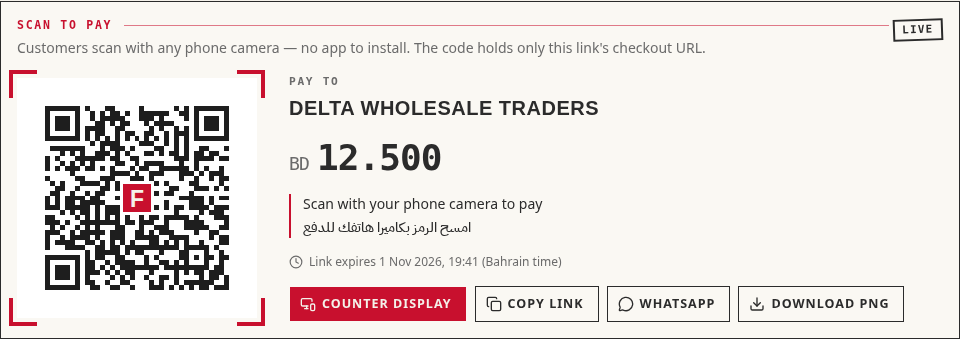
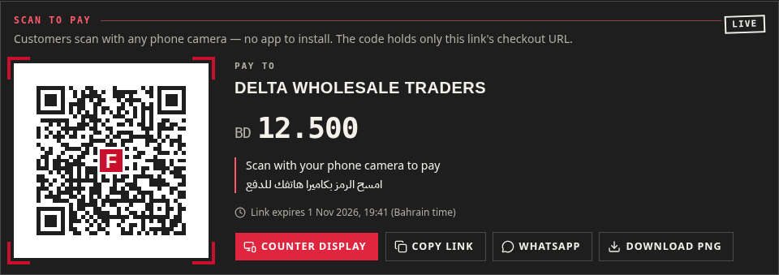

**On the payment-link page**

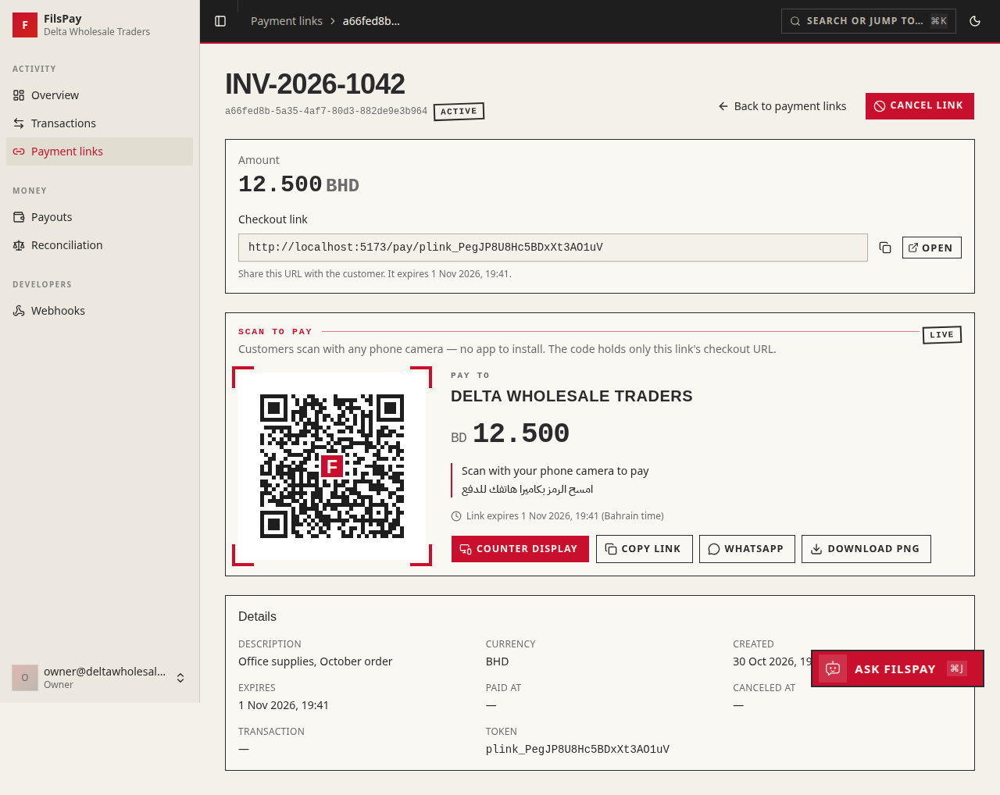

**Counter display, then the moment the customer pays** (the merchant's screen flipped to "Paid" by itself, about 4 s after the Arabic phone checkout below completed)

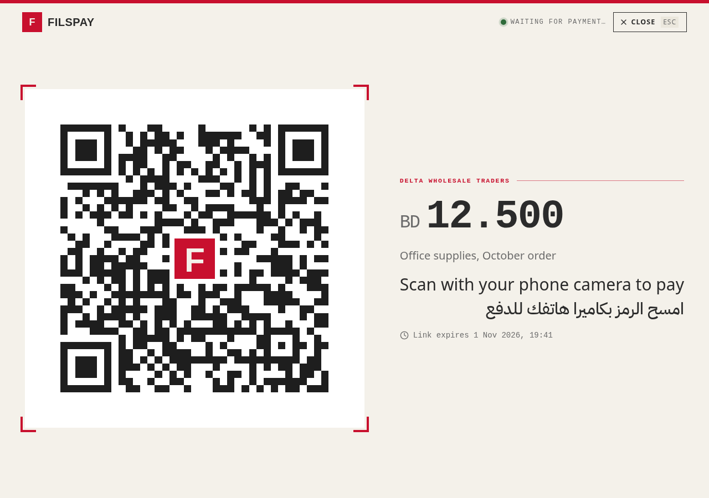
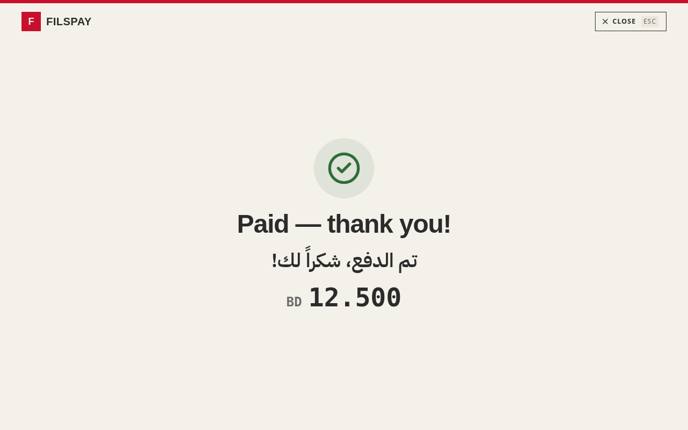

**Download PNG** (printable counter card)

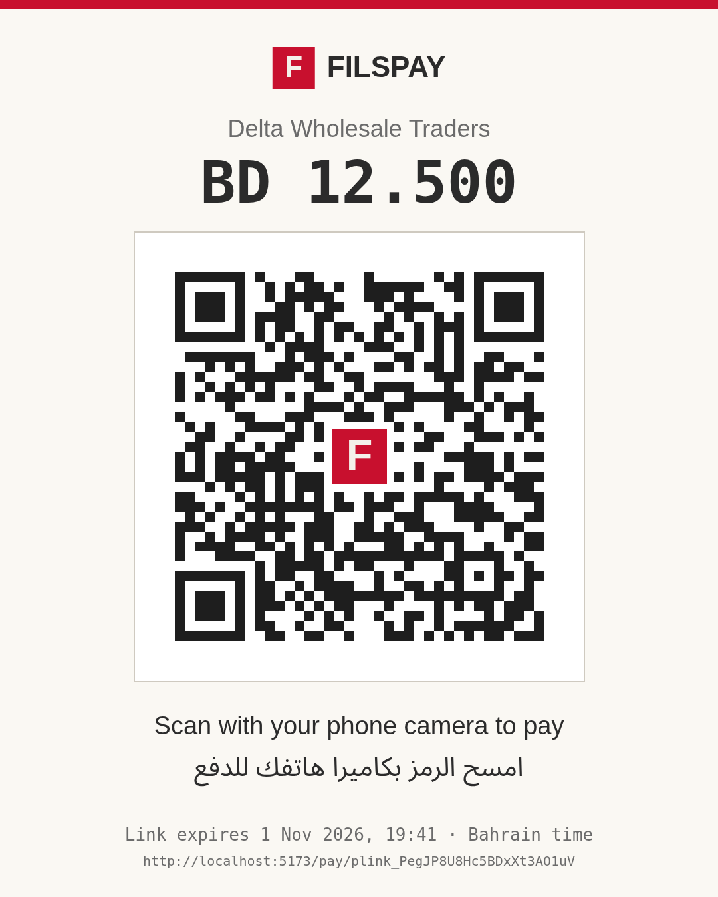

**Checkout: English and Arabic, phone (390×844)**

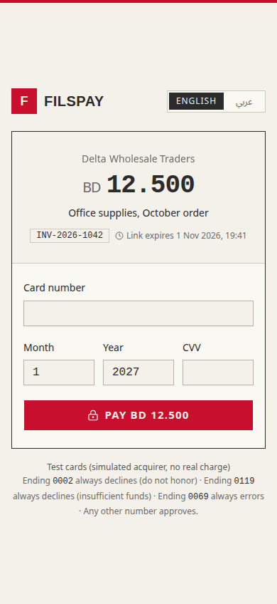 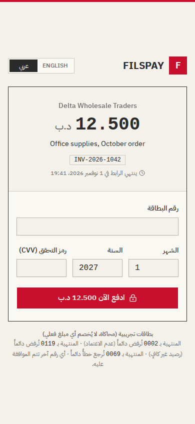

**Arabic: declined (test card ending 0002), then paid**

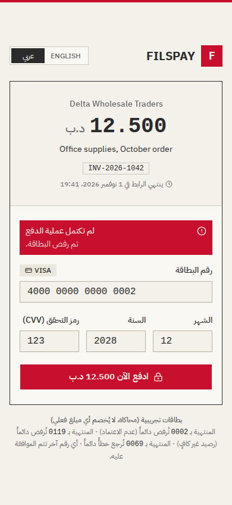 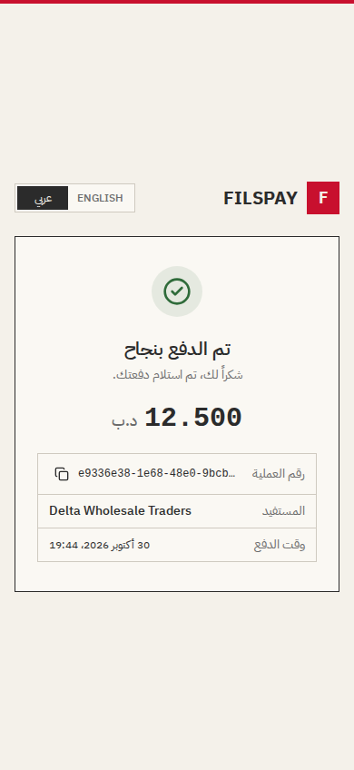

**Desktop**

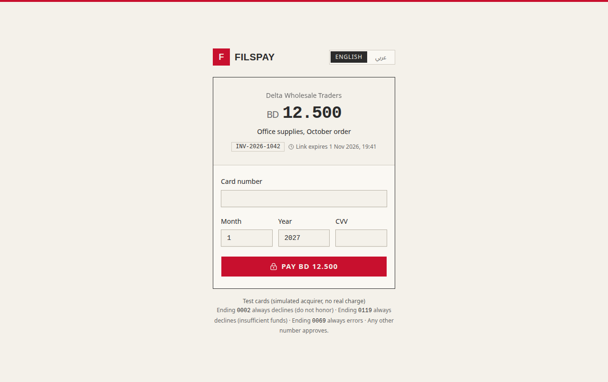
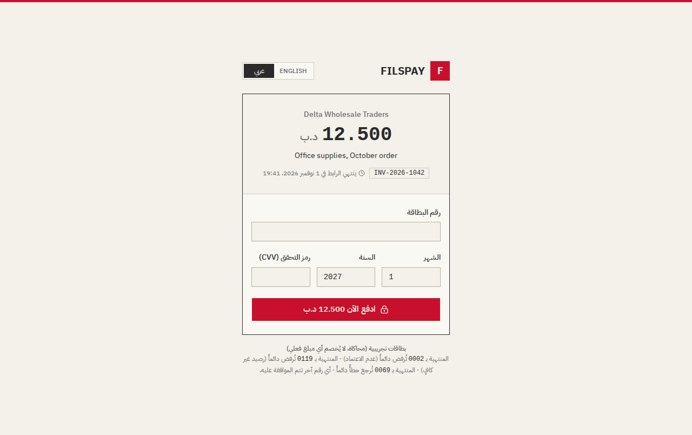

**After payment, the card shows a stamp instead of a QR**

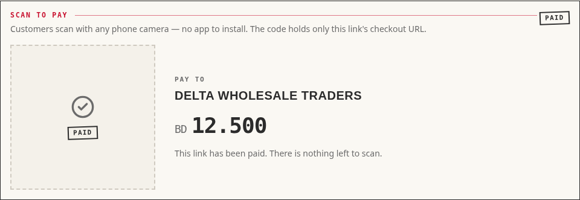

## 6. Follow-ups

- **Compact "QR" action on the payment-links list.** Left out on purpose: the list page was being changed at the same time (UX work). It is a one-line link to `/dashboard/payment-links/:id` once that work is merged.
- **Server-made QR PNG** for the payment-link email or SMS (option 3 above).
- **Arabic for the merchant dashboard.** The dictionary pattern in `i18n/checkout.ts` can be reused there.
- **Optional Arabic-Indic digits** setting, if a merchant asks for it.
- **Counter display** could also show "processing" while a payment is in progress (today it waits for "paid").
